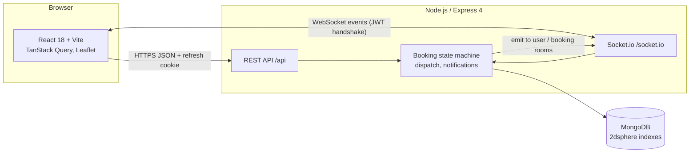

# RepairHub

On-demand home and device repair marketplace for the Kathmandu Valley. Customers post a repair
request; nearby verified, online technicians are found with MongoDB geospatial queries and alerted
in real time; the first to accept proposes an arrival time; the customer confirms or asks for
another; the customer then follows the technician live on a map until the job is done and reviewed.

## Features

- **Customers**: 3-step request form (category, photos, map / GPS / saved address, preferred time),
  live 6-step tracker, proposal accept / new time / choose another technician, live technician map
  with ETA, chat, cancel, reviews, saved addresses, notifications.
- **Technicians**: onboarding (services, radius, base location), Online switch with background GPS,
  live nearby requests with sound, accept with quick time slots, job actions (propose, on the way with
  live location sharing, start, complete, release), earnings and reviews.
- **Admins**: dashboard charts, technician verification queue, users, bookings with full timeline and
  notified technicians, categories.
- **Platform**: one booking state machine on the server; buttons rendered only from `allowedActions`;
  first-accept-wins with an atomic update; JWT access tokens in memory plus rotating httpOnly refresh
  cookies with reuse detection; Socket.io rooms per user and booking; CSP, CORS allow-list, NoSQL
  injection stripping, rate limits; Docker and Nginx deployment.

## Architecture



## Folder structure

```
repairhub/
├─ backend/                 Express API, Socket.io, Mongoose models, seed, Vitest tests
│  ├─ src/config|models|services|controllers|routes|middleware|validators|sockets|utils|seed|scripts
│  └─ tests/                80 tests (auth, models, dispatch, bookings, sockets, admin, hardening)
├─ frontend/                React app
│  ├─ src/api|context|hooks|lib|components|pages
│  └─ e2e/                  Playwright test + isolated stack script
├─ docs/                    decisions, phase notes, socket events, deployment, E2E guide, Postman
├─ Dockerfile  docker-compose.yml  .env.example (compose variables)
└─ package.json             npm workspaces: backend, frontend
```

## Setup in 5 commands

Prerequisites: Node.js 20+, MongoDB 6+ (local or Atlas).

```bash
npm install
cp backend/.env.example backend/.env          # set MONGODB_URI and two different JWT secrets
npm run seed -w backend -- --reset            # demo data (drops every collection first)
npm run dev                                   # API :5000 + web :5173
# open http://localhost:5173
```

Generate a secret with `node -e "console.log(require('crypto').randomBytes(48).toString('hex'))"`.
The backend refuses to start and lists every bad key if `backend/.env` is incomplete.

## Seeded accounts (password `Password@123`)

| Email                                                  | Role                                    | Good for                                                            |
| ------------------------------------------------------ | --------------------------------------- | ------------------------------------------------------------------- |
| admin@repairhub.test                                   | admin                                   | stats, verification queue (Pasang), users, bookings, categories     |
| sita@repairhub.test                                    | customer                                | open AC request, confirmed electrical job, completed + reviewed job |
| ram@repairhub.test                                     | customer                                | pending proposal, live ON_THE_WAY tracking                          |
| gita@repairhub.test                                    | customer                                | waiting for a re-proposal, repair in progress                       |
| bikash@repairhub.test                                  | technician (AC, Koteshwor)              | nearby requests, accept, live location                              |
| anil@repairhub.test                                    | technician (Electrical/AC, Maharajgunj) | second technician for race tests                                    |
| sunita, rajesh, prakash, sarita, dipak @repairhub.test | technicians                             | jobs in other states                                                |
| pasang / manoj / nabin @repairhub.test                 | technicians                             | edge cases: unverified / offline / radius too small                 |

Full table: [docs/PHASE_2_NOTES.md](docs/PHASE_2_NOTES.md#seed-accounts-npm-run-seed--w-backend----reset-password-password123).

## Scripts (run from the repo root)

| Script                            | What it does                                                                     |
| --------------------------------- | -------------------------------------------------------------------------------- |
| `npm run dev`                     | Backend (`node --watch`, :5000) and Vite (:5173) together                        |
| `npm test`                        | Backend tests (Vitest + supertest + in-memory MongoDB)                           |
| `npm run test:e2e`                | Playwright end-to-end test on an isolated stack (:5100 / :5174)                  |
| `npm run lint` / `npm run format` | ESLint / Prettier                                                                |
| `npm run seed`                    | Seed demo data (`-- --reset` drops collections first; refused in production)     |
| `npm run build`                   | Build the frontend into `frontend/dist`                                          |
| `npm start`                       | Start the backend; in production it also serves `frontend/dist` on the same port |
| `npm run db:indexes`              | Create / sync indexes (production deploy step)                                   |

## Documentation

- [docs/DECISIONS.md](docs/DECISIONS.md): binding architecture decisions
- [docs/PHASE_1_NOTES.md](docs/PHASE_1_NOTES.md) · [PHASE_2_NOTES.md](docs/PHASE_2_NOTES.md) (endpoint
  table) · [PHASE_3_NOTES.md](docs/PHASE_3_NOTES.md) · [PHASE_4_NOTES.md](docs/PHASE_4_NOTES.md)
- [docs/SOCKET_EVENTS.md](docs/SOCKET_EVENTS.md): events, rooms, payloads
- [docs/DEPLOYMENT.md](docs/DEPLOYMENT.md): production env, Docker, Atlas, Nginx
- [docs/E2E_TESTING_GUIDE.md](docs/E2E_TESTING_GUIDE.md): manual two-browser guide + Playwright
- [docs/RepairHub.postman_collection.json](docs/RepairHub.postman_collection.json): API collection

## Troubleshooting

- **"Can't extract geo keys" or `$geoNear requires a 2dsphere index`**: indexes are missing. In
  development they sync at start-up; in production run `npm run db:indexes`. A location field must
  be either a full GeoJSON Point or absent, never `{ type: 'Point' }` without coordinates.
- **Technicians are never matched / distances look wrong**: coordinates are swapped. GeoJSON is
  `[longitude, latitude]` (Kathmandu is `[85.32, 27.71]`). The API takes named `{ lng, lat }` fields
  precisely to avoid this; never send a bare array.
- **Logged out on every reload**: the refresh cookie is not being sent. In development open the app
  on http://localhost:5173 (the Vite proxy keeps `/api` same-origin); calling `:5000` from a page on
  `:5173`, or using `127.0.0.1` for one and `localhost` for the other, drops the cookie. In production
  `COOKIE_SECURE=true` requires HTTPS.
- **Leaflet marker icons missing (broken images)**: Vite rewrites asset URLs, so Leaflet cannot find
  its default icons. `src/components/map/MapView.jsx` imports the PNGs explicitly; reuse
  `customerIcon` / `technicianIcon` from there for new maps.
- **"Use my current location" does nothing**: browsers only allow geolocation on `https` or
  `localhost`, and only after the user allows it. Use the map or manual coordinates otherwise.
- **CORS or Socket.io connection refused**: `CLIENT_URL` must match the browser origin exactly
  (scheme, host, port, no trailing slash); list several with commas.
